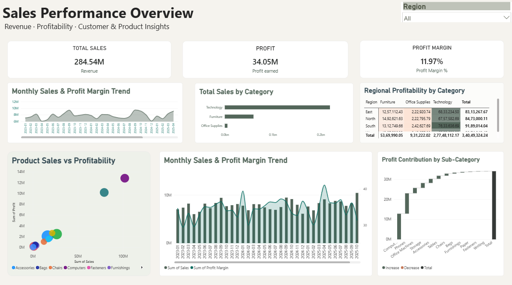

# Sales & Customer Analytics

## Project Overview

This project analyzes retail sales and customer data to identify sales trends, profitability patterns, customer performance, product performance, and regional business insights.

The project uses Python for data cleaning, exploratory data analysis, and visualization, along with MySQL for business-focused SQL analysis. A Power BI dashboard is also included to present key business metrics and performance trends visually.

## Business Questions

- How are sales and profit performing over time?
- Which categories and products generate the most revenue?
- Which customers contribute the most sales and profit?
- Which regions perform best?
- How does discounting relate to profitability?
- How does shipping mode affect delivery time?
- Which products have relatively low profitability?

## Tools & Technologies

- Python
- Pandas
- NumPy
- Matplotlib
- Seaborn
- MySQL
- Power BI
- DAX
- Jupyter Notebook
- Git & GitHub

## Analysis Performed

### Sales Analysis
- Overall sales, profit, quantity, and order KPIs
- Monthly and yearly sales trends
- Average Order Value (AOV)

### Product & Category Analysis
- Category and sub-category performance
- Top products by sales
- Top products by profit
- Least-profitable products
- Product ranking within categories

### Customer Analysis
- Top customers by sales
- Top customers by profit
- Customer-level order analysis

### Regional Analysis
- Sales and profit by region
- Regional profit margins

### Discount Analysis
- Sales and profit across discount levels
- Profit margin by discount level
- Relationship between discount and profit

### Shipping Analysis
- Average shipping time
- Orders and sales by shipping mode

## Power BI Dashboard

The Power BI dashboard presents an overview of sales performance, profitability, and product and regional insights through KPI cards and interactive visualizations.

### Dashboard Preview



### Dashboard Highlights

- **KPI Tracking:** Total Sales, Total Profit, and Profit Margin
- **Sales Trends:** Monthly sales and profit margin analysis
- **Category Analysis:** Sales performance across product categories
- **Regional Profitability:** Profit comparison by region and category
- **Product Analysis:** Sales versus profitability comparison
- **Profit Contribution:** Profit analysis across product sub-categories

### View & Download the Dashboard

📊 **[View Dashboard Preview](powerbi/dashboard-preview.png)**

📥 **[Download the Power BI Dashboard (.pbix)](powerbi/sales.pbix)**

Download the `.pbix` file and open it using Microsoft Power BI Desktop to explore the report.

## Key Findings

- Total sales were approximately **₹284.54M**.
- Total profit was approximately **₹34.05M**.
- The dataset contains approximately **10,000 orders** and **35,026 units sold**.
- Technology generated the largest sales and profit contribution.
- Office Supplies had the highest profit margin among the three categories.
- The South region generated the highest sales and profit.
- 2025 recorded the strongest annual sales growth in the analyzed period.
- Higher discount levels were associated with lower profit in this dataset.
- Average shipping time was approximately 4 days across shipping modes.

## SQL Analysis

MySQL was used to perform:

- Aggregation and KPI calculations
- GROUP BY and HAVING analysis
- CASE statements
- Customer analysis
- Product analysis
- Discount analysis
- Regional analysis
- JOIN operations
- Window functions using RANK()
- Yearly and monthly performance analysis

## Project Structure

```text
sales-customer-analytics/
│
├── data/
│   └── superstore_sales_analytics.csv
│
├── notebook/
│   └── sales_analysis.ipynb
│
├── sql/
│   └── sales_analysis.sql
│
├── src/
│
├── powerbi/
│   ├── sales.pbix
│   └── dashboard-preview.png
│
├── .gitignore
├── README.md
└── requirements.txt
```

## Project Outcome

This project demonstrates practical skills in data cleaning, exploratory data analysis, SQL querying, business intelligence, KPI reporting, and data visualization.

It reflects my ongoing journey in Data Analytics and my interest in transforming raw data into meaningful business insights that support better decision-making.

---

**Author:** Nandana T Arjun